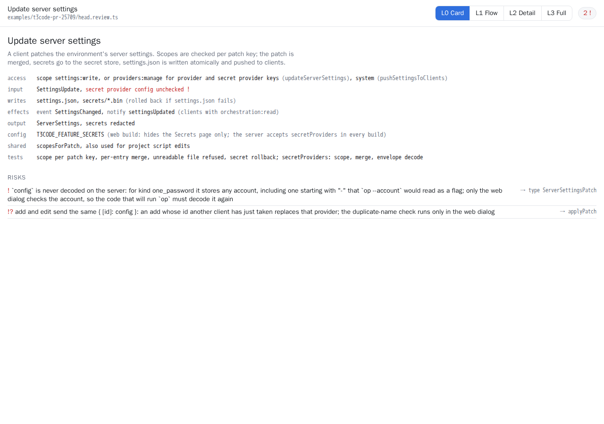
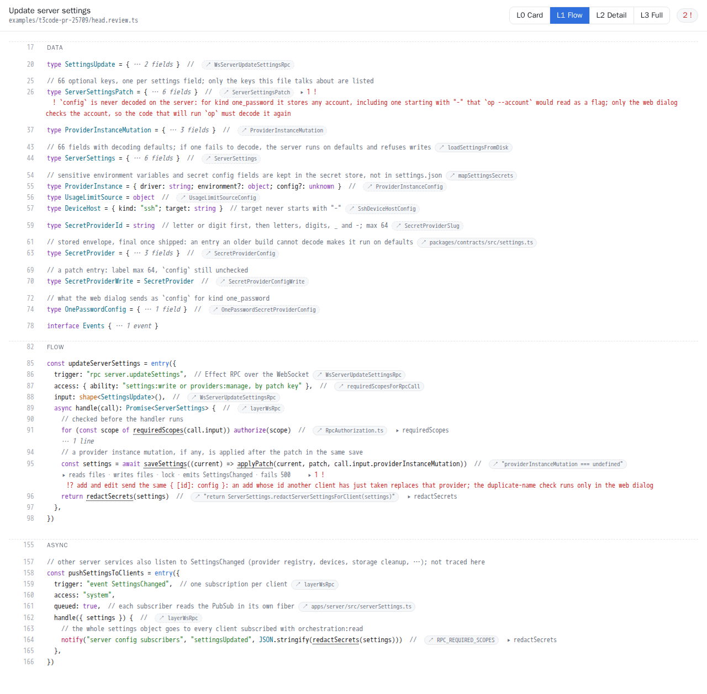
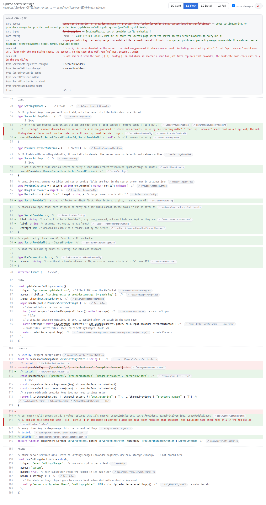
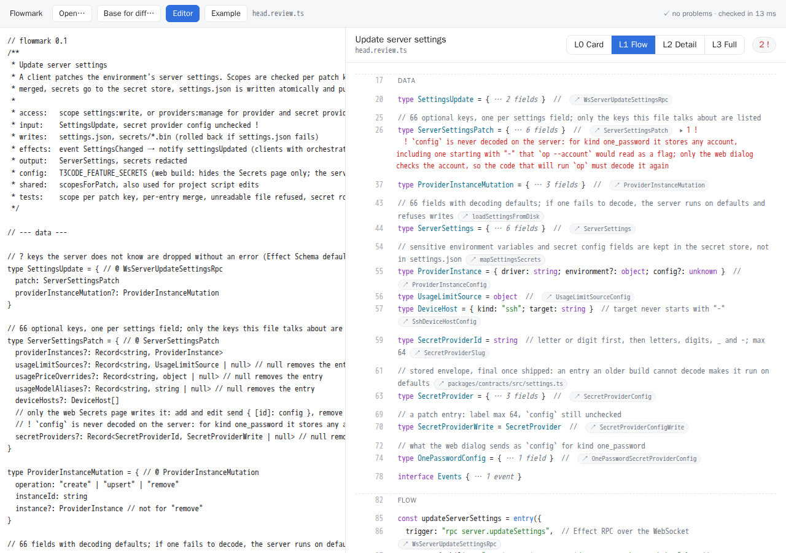
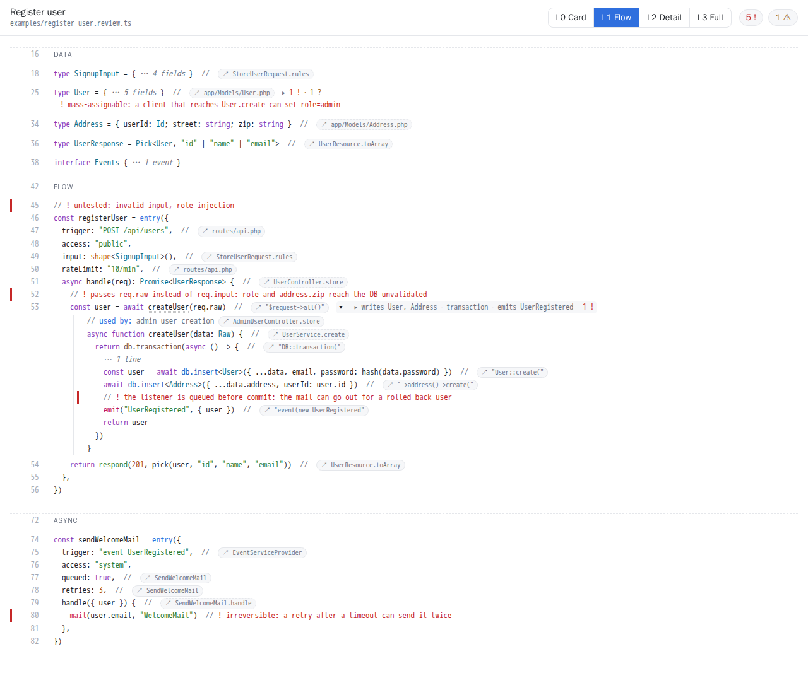

# Flowmark

A code review and documentation language: AI-written, human-read pseudo-TypeScript
that explains what code does, links every claim to the real code, marks what needs
a human's attention, and can be read at four detail levels.

- [`SPEC.md`](SPEC.md) — the language (draft v0.1)
- [`prelude.d.ts`](prelude.d.ts) — the fixed vocabulary every review file uses
- [`examples/`](examples/) — review files

## Examples

| File | What |
|---|---|
| [`examples/register-user.review.ts`](examples/register-user.review.ts) | The spec's example: a Laravel signup with five risks and one checker finding. |
| [`examples/t3code-pr-25709/`](examples/t3code-pr-25709/) | A real review, written by an AI, of [pingdotgg/t3code#25709](https://github.com/pingdotgg/t3code/pull/25709) ("add and list 1Password secret providers"): [`base.review.ts`](examples/t3code-pr-25709/base.review.ts) at the PR's merge-base, [`head.review.ts`](examples/t3code-pr-25709/head.review.ts) after it, and [`pr.diff`](examples/t3code-pr-25709/pr.diff) between the two. Every ref was checked against the code at its commit. |

## Screenshots

The t3code review at L0 (card and risks):



At L1 (flow): hidden blocks collapse, their risks stay visible, calls to hidden helpers show the helper's effects:



The PR as a diff (`flowmark html base.review.ts head.review.ts`): **Changes | Before | After** in the header,
what changed first, then the changed lines:



The web app (WebAssembly in the browser) with the t3code PR from its **Examples** menu:



The spec example at L1, with the hidden `createUser` helper expanded at its call site:



## Skill (for the AI writer)

[`skills/flowmark-review/`](skills/flowmark-review/SKILL.md) is a Claude Code skill that writes and
updates review files. It covers:
- the workflow (scope, read the code, write, or edit minimally)
- the layout, entries, body rules, refs and detail levels
- PR mode (base and head files)
- a self-check loop with `flowmark check` and the type check
- what to report at the end

It ships the prelude, both examples and the level guide. `scripts/sync-skill.sh` copies them from the
repo, and `npm test` fails when the copies are out of date.

Install it for every project, or for one repo:

```sh
git clone https://github.com/daniel100097/flowmark
cp -r flowmark/skills/flowmark-review ~/.claude/skills/        # every project
cp -r flowmark/skills/flowmark-review <repo>/.claude/skills/   # one repo
```

Then ask, for example, "write a flowmark review for PR 123" or "document how signup works as a flowmark
file", or run `/flowmark-review`. The skill installs the CLI itself if it is missing
(`cargo install --locked --git https://github.com/daniel100097/flowmark flowmark_cli`).

## Layout

| Path | What |
|---|---|
| `crates/flowmark_parser` | Parser, checks, text view and the view model for the viewer. TypeScript syntax from [tsrs](https://github.com/oxc-project/tsrs) (pinned to `v0.23.0`). |
| `crates/flowmark_cli` | The `flowmark` command. |
| `crates/flowmark_wasm` | The same parser as a WebAssembly module (plain C-ABI exports, no imports, no wasm-bindgen). |
| `viewer/` | The interactive viewer: `viewer.js` + `viewer.css`, no dependencies, no build step. |
| `web/` | The browser app: open or drop a file, it is parsed and checked in WebAssembly and shown in the viewer. |

## CLI

```sh
cargo build --release
flowmark=./target/release/flowmark

$flowmark check examples/register-user.review.ts           # diagnostics, exit code 1 on errors
$flowmark view  examples/register-user.review.ts --level 1 # text view, levels 0-3
$flowmark html  examples/register-user.review.ts -o out.html          # interactive viewer, one file
$flowmark html  base.review.ts head.review.ts -o pr.html              # diff: Changes | Before | After
$flowmark parse examples/register-user.review.ts           # document as JSON
$flowmark model examples/register-user.review.ts           # view model JSON (what the viewer renders)
```

`flowmark html` writes one self-contained HTML file (model, script and styles inline): it works
offline and can be attached to a pull request.

## Viewer

- **Levels** L0–L3 (buttons or keys `0`–`3`). L0 is the card, the risks and the checker findings.
- **Hidden blocks** become one line saying what is inside (`▸ writes User, Address · emits UserRegistered · 1 !`);
  click to expand. Hidden risks are always shown under the nearest visible line (SPEC §9.4).
- **Helpers** hidden at the current level show their effects at the call site and can be expanded in place.
- **Refs** are chips with target, quote and scope; click to copy.
- **Prelude calls** are coloured by category (access, input, read, write, effect, output, ...).
- **Diff mode** (two files): **Changes | Before | After** in the header (keys `d`, `b`, `a`). Changes shows a
  "What changed" summary first (card fields, risks, entries, types — SPEC §11.5), then the file with added and
  removed lines; Before and After show each file on its own. "Show changes" (key `c`) shows changed lines at
  every level; collapsed blocks show `Δn` for the changes inside. `Esc` collapses everything again.

## Web app (WebAssembly)

```sh
./scripts/build-web.sh                    # builds web/dist
python3 -m http.server -d web/dist 8080   # any static server; file:// cannot load .wasm
```

Open `http://localhost:8080`, then pick an example from **Examples…** (the t3code PR opens as a diff),
open or drop a `.review.ts` file (two files = base and head), or edit it in the built-in editor:
it is re-checked and re-rendered as you type. Nothing leaves the browser.

URL parameters: `?src=<url>` loads a file, `&base=<url>` compares against a base version, `&level=0..3`.
Raw GitHub URLs work, so a pull request can link straight to its review file.

The module is 2.0 MB (530 KB gzipped). tsrs never frees parsed syntax trees, so the JS wrapper
(`web/flowmark-wasm.js`) starts a fresh instance when memory grows past a limit, and after a crash.

## What `check` covers so far

| SPEC | Check | Status |
|---|---|---|
| §12.1 gate 1 | parses as TypeScript | yes (`E000`) |
| §12.1 gate 2 | version line, card, required card fields in order | yes (`E001`–`E003`) |
| §4 | section names and order | yes (`E010`–`E012`) |
| §12.1 gate 4 | `const <name> = entry({ trigger, access, handle })`, one option per line, known trigger kinds, option order, `input: shape<T>()` only where input comes from outside | yes (`E020`–`E026`, `W024`, `W025`) |
| §12.3 | an entry declares `input`, but `handle` reads `req.raw` | yes (`W060`) |
| §7, §8.3 | comment grammar, quote-only refs need a scope, attachment | yes (`E030`, `E031`, `W040`) |
| §9.3 | level markers without effect; `trigger`/`access`/`input` cannot be lowered | yes (`W050`–`W052`, `E024`) |
| §10.3 | L1/L2 budgets | yes (`W070`, `W071`) |
| §3 | no imports/exports | yes (`E080`) |
| §12.1 gate 3 | refs resolve in the reviewed code | not yet (tree-sitter) |
| §12.2 | card ↔ body | not yet (the parser already collects the effects it needs) |
| §12.3 | type check against the prelude | not yet (tsrs checker) |

## Tests

```sh
cargo test                     # parser, checks, text view snapshots, view model, diff
./scripts/build-web.sh && npm install && npm test   # viewer (jsdom), wasm = CLI output, web app
```

Text view snapshots are in `crates/flowmark_parser/tests/snapshots/`; regenerate them with
`UPDATE_SNAPSHOTS=1 cargo test`.
